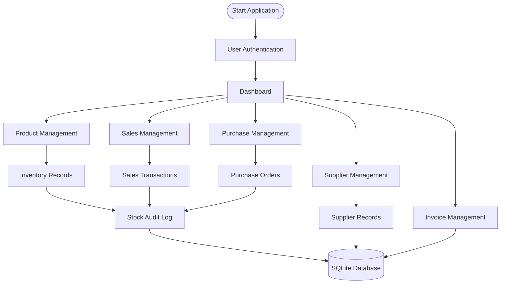

<div align="center">


<br/>

# 📦 Stock Management System

### Inventory Control • Product Tracking • Business Operations

<p>
  
  
  
  
  
</p>

**A web-based inventory management application designed to organize products, manage suppliers, track transactions, and maintain stock records.**

<br/>

[Explore Repository](https://github.com/rohanthanuj06-rgb/STOCK_MANAGEMENT_SYSTEM) • [Report an Issue](https://github.com/rohanthanuj06-rgb/STOCK_MANAGEMENT_SYSTEM/issues)

</div>

---

## 🟢 01 — Project Overview

Managing inventory requires accurate product records, organized supplier information, transaction tracking, and visibility into stock availability.

The **Stock Management System** is a Flask-based web application developed to bring these operations together through a centralized inventory management platform.

The application organizes essential business operations, including product management, supplier records, sales, purchase orders, invoice handling, and stock auditing.

Rather than maintaining disconnected records, the system uses a structured database-backed approach to manage inventory information and transaction history.

### Project Objectives

- Centralize product and inventory information.
- Organize supplier and purchase records.
- Manage sales-related transactions.
- Monitor available, reserved, and damaged stock.
- Maintain records of inventory changes.
- Provide authenticated access to application functionality.

---

## 🧩 02 — Core Modules

<table>
<tr>
<td width="50%">

### 📊 Dashboard
Centralized entry point for accessing inventory and business operations.

### 📦 Product Management
Organize product details, SKU identifiers, categories, prices, and stock information.

### 🏷️ Category Management
Group products into structured categories.

### 🚚 Supplier Management
Maintain supplier contact details and supplier-related purchase information.

</td>
<td width="50%">

### 💰 Sales Management
Maintain sales transactions and associated product quantities.

### 🛒 Purchase Management
Organize supplier purchase orders and their statuses.

### 🧾 Invoice Management
Dedicated application module for invoice-related operations.

### 📋 Stock Audit
Record inventory changes, quantities, reasons, and associated users.

</td>
</tr>
</table>

---

## 📦 03 — Inventory Tracking

The application maintains different stock states for products.

| Stock Attribute | Description |
|---|---|
| Available Stock | Quantity currently available |
| Reserved Stock | Quantity reserved for other operations |
| Damaged Stock | Quantity marked as damaged |
| Minimum Threshold | Configured minimum stock level |

### Stock Status Logic

The application determines product availability using its stock status logic:

| Condition | Status |
|---|---|
| Available stock ≤ 0 | 🔴 Out of Stock |
| Available stock ≤ Minimum Threshold | 🟡 Low Stock |
| Available stock > Minimum Threshold | 🟢 In Stock |

This helps identify products that require attention.

---

## 🔄 04 — Application Workflow



The application uses Flask routes and database models to organize the different modules.

---

## 🏗️ 05 — Technical Architecture

The application follows a modular Flask architecture.

```text
                 USER
                   |
                   v
          Flask Web Application
                   |
          ---------------------
          |         |         |
       Routes    Templates   Static
          |         |        CSS
          |
          v
       SQLAlchemy
          |
          v
       SQLite DB
          |
     Business Records
```

### Repository Structure

```text
STOCK_MANAGEMENT_SYSTEM/
│
├── routes/
│   ├── auth.py
│   ├── dashboard.py
│   ├── products.py
│   ├── suppliers.py
│   ├── sales.py
│   ├── purchases.py
│   ├── audit.py
│   └── invoices.py
│
├── static/
│   └── css/
│
├── templates/
│
├── utils/
│
├── app.py
├── config.py
├── extensions.py
├── models.py
├── init_db.py
├── seed_users.py
├── requirements.txt
└── stock_management.db
```

---

## ⚙️ 06 — Technology Stack

| Technology | Application |
|---|---|
| Python | Backend programming |
| Flask | Web application framework |
| Flask-SQLAlchemy | Database integration |
| SQLite | Data storage |
| Flask-Login | User authentication |
| Flask-Migrate | Database migrations |
| Flask-WTF | Form handling |
| Werkzeug | Password hashing and security utilities |
| HTML / CSS | Web interface |
| Git & GitHub | Version control |

---

## 🚀 07 — Installation & Setup

### Prerequisites

- Python installed
- Git installed
- A code editor such as VS Code

### Step 1 — Clone the Repository

```bash
git clone https://github.com/rohanthanuj06-rgb/STOCK_MANAGEMENT_SYSTEM.git
```

### Step 2 — Navigate to the Project

```bash
cd STOCK_MANAGEMENT_SYSTEM
```

### Step 3 — Create a Virtual Environment

```bash
python -m venv venv
```

Activate it:

**Windows**
```bash
venv\Scripts\activate
```

**Linux / macOS**
```bash
source venv/bin/activate
```

### Step 4 — Install Dependencies

```bash
pip install -r requirements.txt
```

### Step 5 — Initialize the Database

Review `config.py` and `init_db.py` for the project's database initialization requirements before running the application.

### Step 6 — Run the Application

```bash
python app.py
```

Open the local address displayed by Flask in your browser.

---

## 🔐 08 — Data & Authentication

The project includes an authentication model with:

- Username and email fields.
- Password hashing using Werkzeug.
- Flask-Login integration.
- User roles: Admin, Manager, and Staff.

The application also maintains structured records for products, suppliers, sales, purchase orders, and stock audit activity.

**Security note:** Configure a secure Flask secret key before deployment. Do not expose production credentials or sensitive configuration in the repository.

---

## 🖥️ 09 — Screenshots & Demonstration

Screenshots can be added here to demonstrate the actual application interface.

Suggested repository organization:

```text
assets/
└── screenshots/
    ├── login.png
    ├── dashboard.png
    ├── products.png
    ├── suppliers.png
    ├── sales.png
    ├── purchases.png
    └── stock-audit.png
```

Once screenshots are added, display them using:

```markdown

```

---

## 🧠 10 — Engineering Concepts Demonstrated

- Modular application development using Flask Blueprints.
- Relational database modeling.
- Object-relational mapping with SQLAlchemy.
- Authentication and password hashing.
- Inventory state management.
- Transaction and purchase-order modeling.
- Database relationships.
- Audit logging.
- Separation of application routes, templates, and static resources.

---

## 🔮 11 — Future Development Roadmap

- [ ] Advanced inventory analytics and visual reports.
- [ ] Low-stock notifications.
- [ ] Exportable inventory and sales reports.
- [ ] Improved search and filtering.
- [ ] Barcode-based product identification.
- [ ] Enhanced role and permission management.
- [ ] Automated backup and deployment support.
- [ ] Responsive dashboard improvements.

---

## 👨‍💻 12 — Developer

<div align="center">

### Rohan Thanuj P.

**B.Tech Information Technology | K. Ramakrishnan College of Engineering**

Interested in building practical software applications through programming, structured engineering, and continuous learning.

<br/>

<a href="https://github.com/rohanthanuj06-rgb">
  
</a>
<a href="https://www.linkedin.com/in/rohan-thanuj-9b451b352">
  
</a>

<br/><br/>

**Designed to bring inventory operations into one organized system.**


</div>
